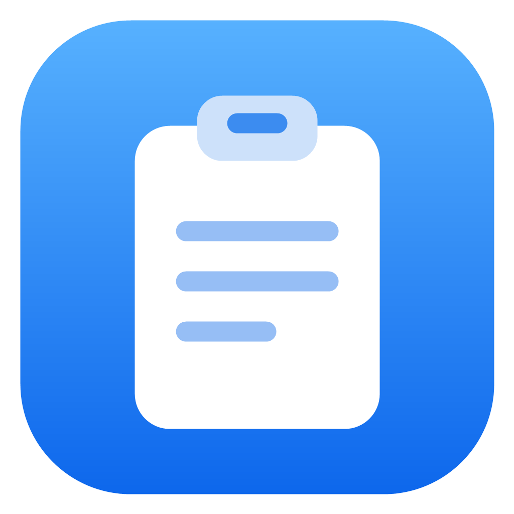
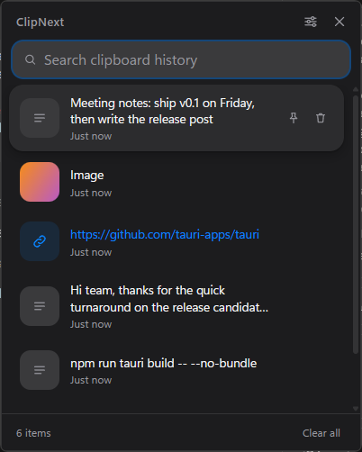
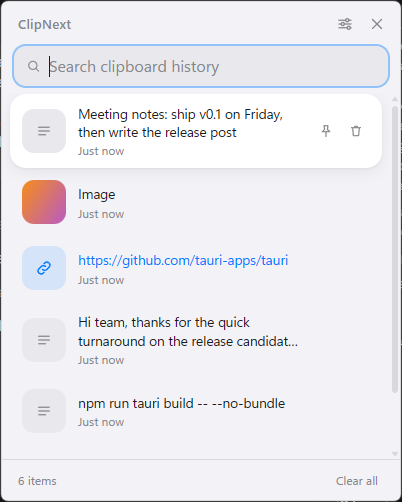
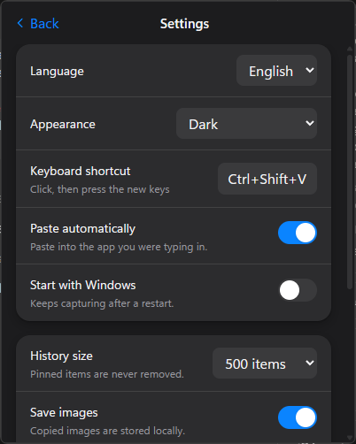

<p align="center">
  
</p>

<h1 align="center">ClipNext</h1>

<p align="center">
  Windows için küçük, hızlı ve gizliliğe saygılı bir pano geçmişi yöneticisi.<br>
  Türkçe · <a href="README.md">English</a>
</p>

<p align="center">
  
  &nbsp;
  
</p>

ClipNext kopyaladığın her şeyi (metin, bağlantı ve görsel) hatırlar, yalnızca
senin bilgisayarında saklar ve tek bir kısayolla istediğini yeniden
yapıştırmanı sağlar. Sistem tepsisinde sessizce çalışır ve çok az bellek
kullanır.

## Özellikler

- **Metin, bağlantı ve görsel geçmişi**, en yeni en üstte (varsayılan 500 öğe, ayarlanabilir)
- **Anlık arama**, büyük/küçük harf ve Türkçe karakter duyarlı
- **Genel kısayol** (varsayılan `Ctrl+Shift+V`, değiştirilebilir) paneli yazdığın metin kutusunun hemen üstünde açar
- **Tek tıkla yapıştır**: öğeyi seç, o an kullandığın uygulamaya yapıştırılır
- **Çoklu görsel seçimi**: farenin orta tuşuyla birkaç görseli işaretle, hepsini art arda yapıştır
- **Sabitleme**: sabitlenen öğeler silinmez, listenin üstünde kalır
- **Açık, koyu veya Windows varsayılanı** tema; Türkçe ve İngilizce arayüz
- **Tepsi uygulaması**: kapat düğmesi pencereyi gizler, tepsi menüsündeki "Çıkış" uygulamayı kapatır
- **Windows ile başlat** (isteğe bağlı, varsayılan kapalı)
- **%100 yerel**: ağ erişimi yok, telemetri yok, hesap yok

## İndirme ve kurulum

1. [Releases](../../releases/latest) sayfasını aç ve `ClipNext.exe` dosyasını indir.
2. İstediğin klasöre koy ve çift tıkla. Kurulum gerekmez.
3. Dosya kod imzalı olmadığı için Windows SmartScreen "bilinmeyen yayıncı"
   uyarısı verebilir. **Ek bilgi → Yine de çalıştır** seçeneğini kullan.

Gereksinimler: Windows 10 veya 11 (64 bit). Microsoft Edge WebView2 gerekir;
Windows 11'de ve çoğu Windows 10 kurulumunda zaten vardır.

## Nasıl çalışır?

1. `ClipNext.exe` dosyasını başlat. Tepsi simgesi belirir ve uygulama arka planda panoyu izlemeye başlar.
2. Her zamanki gibi herhangi bir yerde bir şey kopyala.
3. Herhangi bir uygulamada yazarken `Ctrl+Shift+V` tuşlarına bas. ClipNext paneli imlecin üstünde açılır.
4. Fareyle bir öğe seç ya da yön tuşları ve `Enter` kullan. Panel kapanır ve öğe geldiğin uygulamaya yapıştırılır.

<p align="center">
  
</p>

### Klavye

| Tuş | İşlem |
| --- | --- |
| `Ctrl+Shift+V` (değiştirilebilir) | Paneli aç veya gizle |
| `↑` / `↓` | Seçimi hareket ettir |
| `Enter` | Seçili öğeyi yapıştır |
| `Esc` | Aramayı temizle, sonra paneli kapat |
| Orta tık / `Ctrl+tık` / `Ctrl+Boşluk` | Görseli çoklu seçime ekle veya çıkar |
| `Enter` (çoklu seçim varken) | Seçili tüm görselleri sırayla yapıştır |
| `Ctrl+P` | Seçili öğeyi sabitle veya sabitlemeyi kaldır |
| `Delete` | Seçili öğeyi sil (arama kutusu boşken) |
| `Ctrl+,` | Ayarları aç veya kapat |

### Birden fazla görsel yapıştırma

Bir görsele orta tıkla (veya `Ctrl+tık`) ve işaretle; numaralı rozet sırayı gösterir.
İstediğin kadar görsel işaretle, sonra `Enter`'a bas veya **N görseli yapıştır**'a tıkla.
ClipNext bunları geldiğin uygulamaya yaklaşık yarım saniye arayla art arda yapıştırır;
böylece sohbet uygulamaları ve editörler her görseli ayrı alır. `Esc` seçimi temizler.
Yalnızca görseller çoklu seçilebilir ve yapıştırdığın uygulamanın görsel yapıştırmayı
kabul etmesi gerekir. *Otomatik yapıştır* kapalıysa yalnızca son görsel panoya kopyalanır.

### Ayarlar

| Ayar | Açıklama |
| --- | --- |
| Dil | Sistem, Türkçe veya English |
| Görünüm | Windows varsayılanı, Açık veya Koyu |
| Klavye kısayolu | Düğmeye tıkla ve yeni tuş kombinasyonuna bas (en az bir değiştirici tuş) |
| Otomatik yapıştır | Önceki uygulamaya yapıştır ya da yalnızca panoya kopyala |
| Windows ile başlat | Oturum açtığında tepside gizli başlar |
| Geçmiş boyutu | Sabitlenmemiş kaç öğenin saklanacağı |
| Görselleri kaydet / Görsel depolama sınırı | Görsel yakalamayı kapat veya kullanılan disk alanını sınırla |

## Gizlilik

- Tüm veriler `%APPDATA%\com.clipnext.app\` klasöründe durur (bir SQLite veritabanı ve `images` klasörü). Hiçbir şey dışarı gönderilmez, uygulamanın ağ izni yoktur.
- Şifre yöneticilerinin gizli işaretlediği içerikler (Windows pano biçimleri `ExcludeClipboardContentFromMonitorProcessing`, `Clipboard Viewer Ignore` ve `CanIncludeInClipboardHistory = 0`) asla kaydedilmez.
- Görsel depolama sınırlıdır: 10 MB üstü dosyalar atlanır, büyük görseller 3840 px'e küçültülür ve toplam görsel alanı sınırlanır (varsayılan 200 MB). Sahipsiz dosyalar açılışta temizlenir.
- Geçmişi, tüm görselleri veya sabitlenenler dahil her şeyi uygulamanın içinden temizleyebilirsin.

## Kaynaktan derleme

Gereksinimler: Node.js 20+, Rust (stable, MSVC), "Desktop development with
C++" iş yüküyle Visual Studio Build Tools, WebView2.

```bash
npm install
npm run tauri dev                    # sıcak yenilemeyle çalıştır
cd src-tauri && cargo test           # arka uç birim testleri
npm run tauri build -- --no-bundle   # tek exe: src-tauri/target/release/clipnext.exe
```

Gerçek geçmişine dokunmadan denemek için `CLIPNEXT_DATA_DIR` ortam değişkeniyle
ayrı bir veri klasörü kullanabilirsin.

## Proje yapısı

```
src/              React + TypeScript + Tailwind arayüzü
  components/     liste, öğe, ayarlar, diyaloglar, ikonlar
  services/       arka uç çağrıları, biçimlendirme, kısayol yardımcıları
  i18n/           İngilizce ve Türkçe metinler
src-tauri/        Rust arka ucu (Tauri 2)
  src/db/         SQLite erişimi, sürümlü migration'lar, testler
  src/clipboard/  pano dinleyicisi, sınıflandırma, görsel depolama
  src/focus.rs    imleç bulma, pencere konumu, yapıştırma
```

Veritabanı şema değişiklikleri `src-tauri/src/db/migrations.rs` içindeki
sürümlü migration'lardır (`PRAGMA user_version` ile izlenir); böylece mevcut
geçmiş güncellemelerde korunur.

## Katkı

Issue ve pull request'ler memnuniyetle karşılanır. Pull request açmadan önce
`cargo test` ve `npx tsc --noEmit` komutlarını çalıştır.

## Lisans

[MIT](LICENSE)
